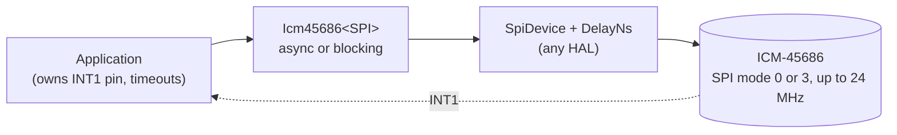

# icm45686

Driver for the TDK InvenSense ICM-45686 six-axis IMU over SPI. It is `no_std` and written against the `embedded-hal` 1.0 and `embedded-hal-async` 1.0 traits only (plus optional `defmt`); it owns no pin, timer, executor or HAL. The crate root is the async driver; the `blocking` module runs the same code on the blocking traits. It was written for the MARV V2 Rev 1 flight controller and has been run on that board only. Version 0.1.0; the API may still change.



## Quick start

The configuration structs are `#[non_exhaustive]`: build them with `Config::new()` and the `with_*` setters, not with a struct literal.

```rust,no_run
# use core::convert::Infallible;
# use embedded_hal::spi::{ErrorType, Operation};
# use embedded_hal_async::{delay::DelayNs, spi::SpiDevice};
# struct Spi;
# impl ErrorType for Spi { type Error = Infallible; }
# impl SpiDevice for Spi {
#     async fn transaction(&mut self, _ops: &mut [Operation<'_, u8>]) -> Result<(), Infallible> { Ok(()) }
# }
# struct Delay;
# impl DelayNs for Delay { async fn delay_ns(&mut self, _ns: u32) {} }
use icm45686::{
    AccelFullScale, Config, FifoConfig, FifoFrame, FifoMode, GyroFullScale, Icm45686, Int1Config,
    fifo_frames,
};

# async fn single(spi: Spi, mut delay: Delay) -> Result<(), icm45686::Error<Infallible>> {
let config = Config::new()
    .with_accel_fs(AccelFullScale::G4)
    .with_gyro_fs(GyroFullScale::Dps250)
    .with_int1(Int1Config::new().with_data_ready(true));
let mut imu = Icm45686::new(spi);
imu.init(&mut delay, &config).await?;
loop {
    // Wait for the INT1 edge here: the application owns the pin (and any timeout).
    let sample = imu.read().await?;
    let accel = sample.accel_ms2(config.accel_fs); // [f32; 3], m/s^2
    let gyro = sample.gyro_rads(config.gyro_fs); // [f32; 3], rad/s
    let temperature = sample.temperature_c(); // degrees Celsius
#   let _ = (accel, gyro, temperature);
}
# }
// FIFO: a watermark of 32 frames on INT1, read into a caller buffer, decoded in place.
# async fn batch(spi: Spi, mut delay: Delay) -> Result<(), icm45686::Error<Infallible>> {
let fifo = FifoConfig::new().with_mode(FifoMode::Stream).with_watermark(32).with_timestamp(true);
let config = Config::new().with_fifo(fifo).with_int1(Int1Config::new().with_fifo_threshold(true));
let mut imu = Icm45686::new(spi);
imu.init(&mut delay, &config).await?;
let mut buf = [0u8; 16 * 40];
// ... wait for INT1 (watermark) ...
let read = imu.fifo_read(&mut buf).await?;
for frame in fifo_frames(&buf[..read.bytes], &config.fifo) {
    if let FifoFrame::AccelGyro(f) = frame {
#       let _ = (f.accel, f.gyro, f.timestamp);
    }
}
# Ok(())
# }
```

`icm45686::blocking::Icm45686` has the same methods without `async`, on a blocking `embedded_hal::spi::SpiDevice` and `embedded_hal::delay::DelayNs`.

## Docs

| Page | In one line |
|---|---|
| [docs/driver.md](docs/driver.md) | What the driver does, what the application provides, rules for correct use, what is not covered |
| [docs/device.md](docs/device.md) | Registers, timing, external clock, FIFO behaviour, pins, datasheet |
| [hil/README.md](hil/README.md) | On-board test programs and how to run them |

## Status

- Host tests (no hardware): `cargo test --locked`. They cover the register plan, configuration validation, FIFO decode, the self-test sequence, verify and the blocking front-end against a fake bus.
- On the board (MARV V2 Rev 1, SPI0): smoke, FIFO, modes, calibration, cancel, self-test, INT1 and soak programs pass; see [hil](hil/README.md).
- Cargo feature `defmt` (off by default) adds `defmt::Format` to the public data and error types.
- Not exercised on the real sensor: the bandwidth, anti-alias, RTC-align and SPI-slew setters, and full scales other than 4 g / 16 g and 250 dps; see [driver](docs/driver.md).

## Used by

The MARV V2 flight-controller firmware ([MARV-FC](https://github.com/Lmx154/MARV-FC)) pins this crate.

## MARV project

| Repository | Role |
|---|---|
| [MARV-FC](https://github.com/Lmx154/MARV-FC) | Flight-controller firmware for the MARV V2 board (RP2350B) |
| [MARV-GCS](https://github.com/Lmx154/MARV-GCS) | Ground station (`marv-gcs`) and command line (`marv-cli`) |
| [MARV-sim](https://github.com/Lmx154/MARV-sim) | Simulator that runs the firmware's flight code |
| Sensors | **icm45686** · [lsm6dsk320x](https://github.com/Lmx154/lsm6dsk320x-rs) · [bmp581](https://github.com/Lmx154/bmp581-rs) · [bmm350](https://github.com/Lmx154/bmm350-rs) · [sam-m10q](https://github.com/Lmx154/sam-m10q) · [adc-battery](https://github.com/Lmx154/adc-battery) |
| Board I/O | [pio-sdmmc](https://github.com/Lmx154/pio-sdmmc-rs) · [qmi-psram](https://github.com/Lmx154/qmi-psram-rs) · [ws2812c](https://github.com/Lmx154/ws2812c-rs) · [usb-cdc](https://github.com/Lmx154/usb-cdc) · [pio-uart](https://github.com/Lmx154/pio-uart) |
| Motors and links | [dshot](https://github.com/Lmx154/dshot-rs) · [esc-passthrough](https://github.com/Lmx154/esc-passthrough) · [rc-port](https://github.com/Lmx154/rc-port) · [crsf-codec](https://github.com/Lmx154/crsf-codec) · [mavlink-device](https://github.com/Lmx154/mavlink-device) · [marv-dialect](https://github.com/Lmx154/marv-dialect) |
| Other drivers | [lc76g](https://github.com/Lmx154/lc76g-rs) (Quectel LC76G GNSS) |

## License

MIT, see `LICENSE`. The driver is written from the datasheet linked in [docs/device.md](docs/device.md); the self-test sequence follows TDK's public driver (facts only, see `src/selftest.rs`).
