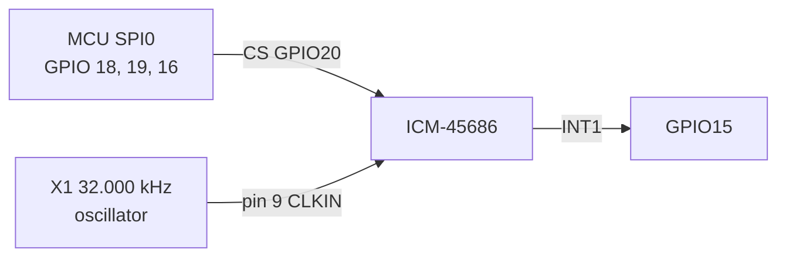

# ICM-45686 device facts

Part of [icm45686](../README.md)

Register, timing and board facts the driver was written against (MARV V2 Rev 1, IMU on SPI0). Page numbers are PDF pages of the datasheet linked at the end. Items marked UNKNOWN are not established. Figures labelled observed were seen on the MARV V2 board (RP2354B at 150 MHz, embassy-rp 0.10); they are not guarantees.

## Bus

- SPI: first byte bit 7 = 1 for read, bits 6:0 address; MSB first; burst read supported; max 24 MHz (p49).
- WHO_AM_I 0x72 = 0xE9 (p107).
- Register access is allowed 1 ms after power-up; accel start-up about 10 ms (p19, p21).
- Observed: one `read()` (15 bytes on the wire) takes a median 27 us at 7.5 MHz in SPI mode 0 and 16.3 us at 18.75 MHz in mode 3. A burst costs 9.5 bit times per byte in mode 0 and 8.0 in mode 3 on the RP2350 PL022 block, so mode 3 saves about 16 % of bus time. A clock sweep 7.5 to 18.75 MHz in mode 0 and mode 3 at 7.5 and 18.75 MHz gave no wrong reads in 10 000 each.

## Registers

| Register | Address | Fields |
|---|---|---|
| PWR_MGMT0 | 0x10 | bits 3:2 GYRO_MODE, bits 1:0 ACCEL_MODE; 11 = low noise; 6-axis low noise = 0x0F (p70) |
| ACCEL_CONFIG0 | 0x1B | bits 6:4 FS (000 = +-32 g, 001 = 16, 010 = 8, 011 = 4, 100 = 2); bits 3:0 ODR (0111 = 400 Hz, 1000 = 200, 1001 = 100); reset 0x06 = +-32 g, 800 Hz (p78) |
| GYRO_CONFIG0 | 0x1C | bits 7:4 FS (0000 = +-4000, 0001 = 2000, 0010 = 1000, 0011 = 500, 0100 = 250 dps); bits 3:0 ODR, same codes; reset 0x06 (p79) |
| Data | 0x00-0x0D | accel X 0x00/01, Y 0x02/03, Z 0x04/05; gyro X 0x06/07, Y 0x08/09, Z 0x0A/0B; temperature 0x0C/0D (p67-69) |
| INT1_CONFIG0 | 0x16 | bit 2 data-ready on INT1; reset 0x80 (p72) |
| INT1_CONFIG2 | 0x18 | bit 2 drive (0 push-pull), bit 1 mode (0 pulse), bit 0 polarity (1 active high); reset 0x04; push-pull, pulse, active high = 0x01; write with interrupts disabled (p75) |
| REG_MISC2 | 0x7F | bit 1 SOFT_RST (self-clearing), bit 0 IREG_DONE (p109) |

Data are little-endian (the datasheet contradicts itself on p57 vs p64; measured). Accel sensitivity in LSB/g: +-32 g 1024, +-16 g 2048, +-8 g 4096, +-4 g 8192, +-2 g 16384 (p19). Gyro sensitivity is in the table on p18; +-250 dps is 131 LSB/dps (measured). Temperature: degC = raw/128 + 25 (p69). After a soft reset RESET_DONE (INT1_STATUS0 bit 7) appears after about 1.06 ms (observed).

## Indirect registers

IREG_ADDR_15_8 0x7C, IREG_ADDR_7_0 0x7D, IREG_DATA 0x7E (p55-56, p108-109). Bases: IPREG_BAR 0xA000, IPREG_TOP1 0xA200, IPREG_SYS1 0xA400, IPREG_SYS2 0xA500. Write = one burst of {addr_hi, addr_lo, data} starting at 0x7C. Read = write the address, CS high, wait at least 4 us, read 0x7E. Wait at least 4 us between accesses.

## External clock

Pin 9 is wired to the 32.000 kHz oscillator X1 (net ICM_CLKIN). CLKIN accepts 20-40 kHz (p37). RTC_CONFIG 0x26 bit 5 RTC_MODE = 1 works only if ACCEL_LP_CLK_SEL = 1, which is bit 4 of SMC_CONTROL_0 at IREG 0xA258 (p178; bit 3 is TEMP_DIS). The datasheet does not say how pin 9 becomes CLKIN; the sequence taken from TDK's reference driver is:

1. IOC_PAD_SCENARIO_OVRD 0x31 = 0x06
2. SIFS_I3C_STC_CFG 0xA268 bit 2 = 0
3. IPREG_SYS2_REG_123 0xA57B (ACCEL_SRC_CTRL) = 2
4. IPREG_SYS1_REG_166 0xA4A6 (GYRO_SRC_CTRL) = 2
5. SMC_CONTROL_0 bit 4 = 1
6. RTC_CONFIG bit 5 = 1

Output data rate scales as CLKIN/32 kHz (TDK application note). Observed at a nominal 200 Hz: 200.895 Hz on the internal oscillator, 200.000 Hz on the external clock; on the external clock the rate is exact up to 3.2 kHz and 6388.7 Hz at the 6.4 kHz setting. The external-clock set-up also changes the filter path, so compare noise only with the filter path held equal.

## FIFO behaviour

- Timestamp tick: frames at 200 Hz were 5022.5 us apart in timestamp units at both 1 us and 16 us per tick while the MCU clock measured 5000.5 us; the tick runs about 0.44 % fast and does not follow the external clock. Timestamps space frames relatively; real time needs a calibration against the application's clock.
- Decimation (FIFO on, 800 Hz, factors 1, 2, 8): INT1 data-ready 800, 400, 100 per second, the data registers changed at the same rates, the FIFO frame rate followed. With the FIFO off the driver does not write the decimation.
- Overflow (2 KB, 16-byte frames, 800 Hz, 350 ms unread): stream mode counts up to capacity + 2 (130); the first two frames of the read are stale, then a timestamp jump, then the newest 127 contiguous. Stop-on-full counts to the capacity (128) and returns the oldest frames. The INT1 FIFO-full flag is set only with its INT1 source enabled.
- Different accel and gyro rates, FIFO off: INT1 follows the faster sensor and each sensor's registers change at its own rate. With the FIFO on both must be equal after decimation.
- `fifo_frames` decode costs 0.50 / 0.56 / 0.77 us per 8 / 16 / 20-byte frame (observed).

## Pins and bus (MARV V2)

All GPIO are 3.3 V logic and not 5 V tolerant.

| GPIO | Net | Function |
|---|---|---|
| 15 | ICM_INT1 | GPIO input, INT1 |
| 16 | ICM_MISO | SPI0 RX |
| 18 | ICM_SCK | SPI0 SCK |
| 19 | ICM_MOSI | SPI0 TX |
| 20 | ICM_CS | GPIO chip select, 10k pull-up R48 to V3V3_ANA |

The bus is 4-wire with no pull resistors on clock or data. Pin 9 (INT2/FSYNC/CLKIN) is used as CLKIN and is not connected to any MCU pin; INT1 is the only interrupt that reaches the MCU. V3V3_ANA (sensors, pull-ups, X1) comes up after V3V3_SYS.

## Datasheet

ICM-45686: https://www.lcsc.com/datasheet/lcsc_datasheet_2411220643_TDK-InvenSense-ICM-45686_C22459454.pdf

## Related

[driver](driver.md) · [hil](../hil/README.md) · [README](../README.md)
