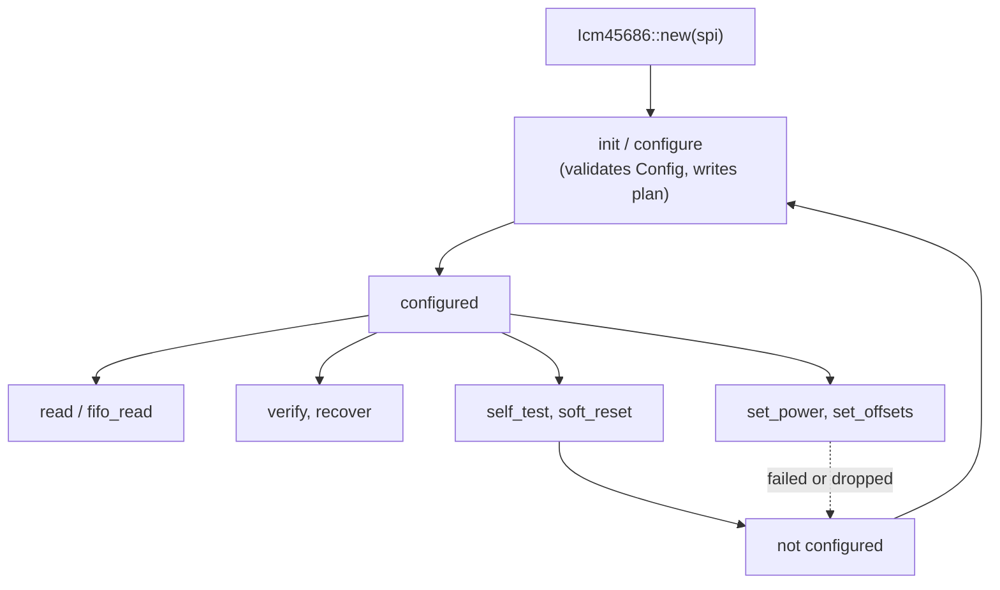

# Driver

Part of [icm45686](../README.md)

What `Icm45686<SPI>` offers, what the application must provide, and the rules that keep it correct. Register and timing facts are in [device](device.md); the on-board checks are in [hil](../hil/README.md).

## What the application provides

| Item | Detail |
|---|---|
| SPI device | `embedded_hal_async::spi::SpiDevice` (async) or `embedded_hal::spi::SpiDevice` (`blocking`); mode 0 or 3, at most 24 MHz |
| `DelayNs` | for `init`, `configure`, `verify`, `recover`, `soft_reset`, `set_power`, `set_offsets`, `fifo_flush`, `self_test` |
| INT1 pin | the application owns the pin and any timeout; `Config::int1` selects the events (data-ready, FIFO threshold, FIFO full, AGC ready), mode, polarity, drive and pulse width. Default: 8 us push-pull active-high pulse, no event enabled |
| 32 kHz clock (optional) | `Config::with_clock(ClockSource::ExternalClkin)`; the board supplies the oscillator, the driver only switches the device to it |

## What the driver does

| Area | API |
|---|---|
| Settings | `Config`, `Config::validate`: accel and gyro full scale and rate set separately (6.4 kHz down to 12.5 Hz), UI low-pass bandwidth, anti-alias FIR/interpolator, per-sensor `SensorPower`, clock source, RTC alignment, SPI slew, INT1 |
| Single sample | `read()` returns a `RawSample` in one transaction; `accel_ms2`, `gyro_rads`, `temperature_c` convert it |
| FIFO | `FifoConfig`: bypass, stream, stop-on-full; 2 KB or 8 KB; 8-byte (one sensor), 16-byte and 20-byte high-resolution frames; watermark; decimation; 1 us or 16 us timestamps. `fifo_read`, `fifo_read_exact`, `fifo_count`, `fifo_flush`, in-place decoder `fifo_frames`, unit helpers in `fifo` |
| Status | `interrupt_status()` (INT1_STATUS0/1, clear on read), `stats()` (overflow, frames-read, bus-error counters) |
| Offsets | `set_offsets`, `offsets`, helpers in `offsets`; `init` zeroes them, `configure` writes the stored value back |
| Power and reset | `set_power`, `soft_reset`, `self_test` (runs on the chip's processor; `SelfTestConfig`, `SelfTestReport`) |
| Health | `verify`, `recover`, `info`, `config`, `release`; `verify_steps` and `verify_step(delay, index)` split `verify` into one step per owned register so an application can spread the check over time |
| Raw access | `read_register(s)`, `write_register(s)`, `ireg_read`, `ireg_write`, register map in `reg` |

## Rules for correct use

- Never cancel a bus transfer in flight: no timeout, `select` or other drop around a driver call that is on the bus; put the timeout around the wait for data-ready. On embassy-rp 0.10 a cancelled SPI transfer leaves stale bytes in the receive FIFO, and cancelled transfers through a shared-bus wrapper wrote stray registers into the sensor, which then stopped answering until power-cycled.
- After any doubt call `recover()`: it re-frames the bus, checks WHO_AM_I and runs `verify()`. `verify()` reads back every register the applied configuration owns and returns `Error::ConfigMismatch` if one differs on two reads; it changes nothing except the indirect address registers.
- Methods return `Error::NotConfigured` until `init` or `configure` has completed. `soft_reset`, `self_test`, `set_power` and a failed or dropped `init`, `configure` or `set_power` clear that state.
- After a `fifo_read` that reports `overflow == Some(true)` in stream mode, discard the first two frames (or `fifo_flush` and discard everything read). In stop-on-full mode the frames returned are the oldest.
- FIFO timestamps space frames relative to each other; they are not real time (the tick runs about 0.44 % fast). `fifo::timestamp_us_with_period` applies a tick period you calibrated.
- After `self_test` the driver is not configured: call `init` or `configure` before reading.
- `init` returns after the sensors have started up, so the first `read()` is valid.
- After `set_power` switches the gyroscope back on, its output wanders by up to about 0.6 dps for at least 100 ms; discard the first 0.2 s if you need settled data.

## Not covered

- Low-power and ultra-low-power modes: `SensorPower` has off, standby and low-noise; `validate` rejects accel standby and rates of 6.25 Hz and below.
- FIFO compression and extended-header frames (they decode as `FifoFrame::Invalid`).
- INT2, I2C, I3C, AUX1/OIS, wake-on-motion and the APEX functions. FSYNC is not offered; a received FSYNC tag is only reported in `FifoFlags`.
- API present but not exercised on the real sensor: `with_accel_bandwidth` / `with_gyro_bandwidth`, `with_accel_anti_alias` / `with_gyro_anti_alias`, `with_rtc_align`, `with_spi_slew`, and full scales other than 4 g and 16 g (accel) and 250 dps (gyro).

## Code

| Path | Contents |
|---|---|
| `src/lib.rs` | `Icm45686`, `Error`, `Info` |
| `src/config.rs`, `src/validate.rs`, `src/plan.rs` | settings, validation, register write plan |
| `src/reg.rs`, `src/image.rs`, `src/owned.rs` | register map, register image, owned-register comparison |
| `src/fifo.rs`, `src/fifo_io.rs`, `src/status.rs` | FIFO config and decode, FIFO reads, status and counters |
| `src/selftest.rs`, `src/offsets.rs`, `src/sample.rs` | self-test, user offsets, raw sample conversion |
| `src/blocking.rs` | blocking front-end |

## Related

[device](device.md) · [hil](../hil/README.md) · [README](../README.md)
